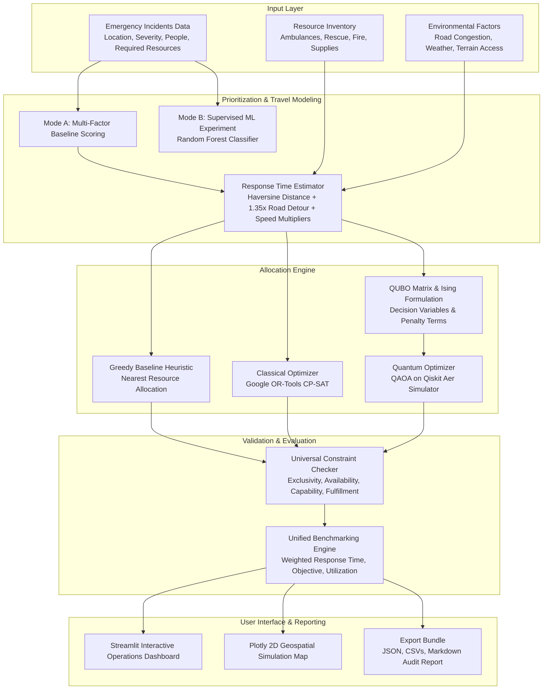

# QRescue: System Architecture

## Overview
**QRescue** is an open-source, AI-assisted disaster response simulation and optimization platform. It combines multi-factor emergency incident triage, realistic response-time estimation, classical mixed-integer constraint programming (OR-Tools CP-SAT), and simulated quantum approximate optimization (QAOA with Qiskit Aer).

---

## Component Architecture

### 1. Data Models (`src/data_models.py`)
- **`Incident`**: Tracks unique ID, coordinates, severity ($1-5$), people affected, required resource types, access difficulty, status, and urgency score.
- **`Resource`**: Tracks ID, unit type, nominal speed (km/h), hourly cost, availability flag, capacity, and operational capability tags.
- **`Scenario`**: Encapsulates incident and fleet state, road congestion multiplier, weather impact, and random seed.
- **`Assignment`**: Connects incidents with assigned resources, travel times, total response times, operating cost, and full fulfillment flags.
- **`OptimizationResult`**: Standardized container holding status (`OPTIMAL`, `FEASIBLE`, `INFEASIBLE`, `NO_SOLUTION`), served and unserved IDs, objective value, runtime, and constraint violation logs.

### 2. Prioritization Engine (`src/prioritization.py`)
- **Mode A (Transparent Baseline):**
  A linear-log weighted composite formula:
  $$\text{Urgency} = \frac{w_{\text{sev}} f_{\text{sev}} + w_{\text{peo}} f_{\text{peo}} + w_{\text{time}} f_{\text{time}} + w_{\text{haz}} f_{\text{haz}} + w_{\text{acc}} f_{\text{acc}}}{\sum w}$$
  Normalizes scores to $[0, 100]$ and categorizes incidents into `Critical` ($\ge 75$), `High` ($\ge 50$), `Medium` ($\ge 30$), and `Low` ($< 30$).
- **Mode B (Supervised ML Experiment):**
  Uses Scikit-Learn's `RandomForestClassifier` trained on reproducible synthetic historical dispatch records. Reports accuracy, precision, recall, F1-score, and feature importances. Clearly noted as a synthetic educational research experiment.

### 3. Response-Time Estimation (`src/response_time.py`)
- Computes Haversine great-circle distances.
- Applies an empirical $1.35\times$ road curvature factor to differentiate straight-line distance from road distance.
- Applies road congestion multipliers ($1.0\times - 2.5\times$) and terrain access difficulty penalties ($1.0\times - 3.0\times$).
- Converts transit hours into minutes and adds estimated on-scene service duration.

### 4. Classical Optimization (`src/classical_optimizer.py`)
- Employs Google OR-Tools CP-SAT (Constraint Programming - Satisfiability).
- Solves for binary decision variables $x_{i, r}$ and incident fulfillment variables $y_i$.
- Enforces strict exclusivity ($\sum_i x_{i,r} \le 1$), availability constraints, capability matches, and multi-resource type requirements.
- Minimizes weighted response time, resource operating costs, and penalties for unserved high-priority emergencies.

### 5. QUBO & Quantum Optimization (`src/qubo_model.py`, `src/quantum_optimizer.py`)
- Formulates the allocation problem as an upper-triangular QUBO matrix $Q$.
- Maps binary variables $x_k \in \{0, 1\}$ to Pauli-$Z$ operators via $x_k = \frac{I - Z_k}{2}$.
- Generates a parameterized QAOA quantum circuit with alternating Cost ($e^{-i \gamma H_C}$) and Mixer ($e^{-i \beta H_M}$) unitaries.
- Executes variational parameter optimization with classical `COBYLA` using Qiskit Aer (`AerSimulator`).
- Decodes measured bitstrings and tests candidate solutions against the unified constraint validator.

### 6. Universal Constraint Validator (`validate_assignments`)
Guarantees unbiased evaluation across all algorithms by independently checking:
- Did any unavailable resource get assigned?
- Did any resource get assigned to multiple simultaneous incidents?
- Did a resource get assigned to an incident whose required types do not include that resource?
- Was an incident falsely marked fully served when missing required capabilities?

---

## Failure Modes & Safeguards
1. **Empty Scenarios:** Gracefully handles zero incidents or zero resources by returning `NO_SOLUTION` and zeroed metrics without crashing.
2. **Resource Exhaustion:** Accurately labels unserved emergencies and imposes prioritized penalties in the objective value.
3. **Quantum Infeasibility:** If the sampled quantum candidate violates exclusivity or type matching, it is marked `INFEASIBLE`, and violations are displayed transparently.
4. **Divide-by-Zero Protection:** Percentage improvement formulas check that baseline costs are strictly positive.
